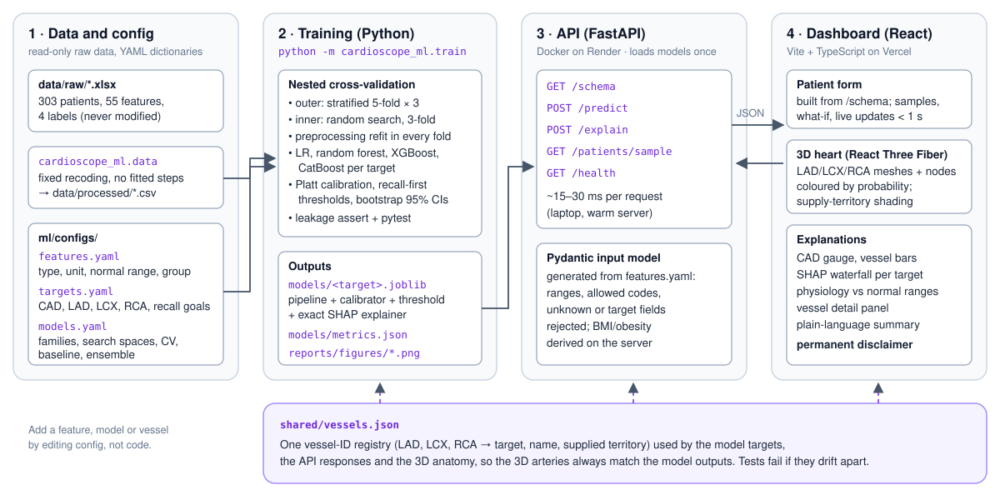

# CardioScope

Interactive 3D cardiovascular risk visualisation: Multimodal AI Hackathon 2026, Track A.

CardioScope predicts overall coronary artery disease (CAD) and the stenosis status of the three
main coronary arteries (LAD, LCX, RCA) from routine clinical data. It maps those probabilities onto
an interactive 3D heart and explains every prediction with exact SHAP values.

> ⚠️ **Clinical disclaimer:** predictions are for decision support / educational purposes only and
> are not a substitute for formal diagnostic imaging (e.g. coronary angiography). The models predict
> per-vessel stenosis status, not the location of a lesion within a vessel.

## Links
- **Live app:** https://frontend-psi-one-41.vercel.app (dashboard at `/app`)
- **API:** https://cardioscope-api.onrender.com (`/health`, `/docs` for the interactive reference)
- **Documentation (6 pages):** [`docs/CardioScope_Documentation.pdf`](docs/CardioScope_Documentation.pdf)
  (source: [`docs/documentation.md`](docs/documentation.md))

The API runs on Render's free plan and sleeps after 15 minutes without requests. The first visit
after that takes ~30–60 s while the dashboard shows "Waking up the model server…".

## Results (nested cross-validation, 303 patients, mean [95% CI])
| Target | Model | ROC-AUC | Recall | Specificity | Brier |
|---|---|---|---|---|---|
| Overall CAD | Logistic regression | **0.929** [0.899–0.955] | 0.889 | 0.816 | 0.095 |
| LAD | Random forest | **0.842** [0.796–0.884] | 0.798 | 0.728 | 0.157 |
| LCX | Random forest | **0.729** [0.674–0.782] | 0.773 | 0.560 | 0.204 |
| RCA | Logistic regression | **0.731** [0.677–0.783] | 0.769 | 0.563 | 0.200 |

- Thresholds are tuned on training folds for ≥ 90 % sensitivity (CAD) and ≥ 80 % (vessels).
- Every model beats "treat all" and "treat none" in a decision-curve analysis.
- The full model clearly beats a 10-item bedside baseline for LAD (+0.064 AUC); for LCX and RCA it
  does not.
- Full details: [`docs/phase2_model_results.md`](docs/phase2_model_results.md).

## Architecture


- **Data and config:**
  - The raw Excel file is never modified.
  - `ml/configs/*.yaml` describe every feature, target and model.
  - `shared/vessels.json` is the one vessel-ID registry for the model, the API and the 3D view.
- **Training (`ml/cardioscope_ml`):**
  - nested CV over four model families per target;
  - Platt calibration and recall-first thresholds;
  - exact SHAP: native TreeSHAP for trees, linear SHAP for logistic regression;
  - an automated target-leakage guard.
- **API (`backend/app`):** FastAPI. Its input model is generated from `features.yaml`.
- **Dashboard (`frontend/`):** React + TypeScript + React Three Fiber.
  - The patient form is built from `/schema`.
  - The 3D heart has separate LAD/LCX/RCA meshes and supply-territory shading.
  - Explanations: SHAP waterfall, physiology panel, vessel detail panel and a plain-language summary.

## Setup
Requires Python 3.10+ (developed and trained on 3.14) and Node 20+ (developed on Node 24).

**Linux / macOS / WSL** (training and the API run on Linux, as in deployment):
```bash
python3 -m venv .venv && source .venv/bin/activate
pip install --upgrade pip
pip install -r requirements.txt
pip install -e ml                       # installs the cardioscope_ml package
```

**Windows:** the same steps work in PowerShell (`py -3 -m venv .venv`, then
`.\.venv\Scripts\Activate.ps1`). On machines with *Smart App Control* enabled, Windows may block
scikit-learn's compiled modules. If so, run the Python parts in WSL (`wsl --install -d Ubuntu-24.04`),
which is what we do. The frontend runs natively on Windows.

## Run
From the repo root, with the virtual environment active:

```bash
python -m cardioscope_ml.data           # raw Excel -> data/processed/cardioscope_clean.csv
python -m cardioscope_ml.train          # nested CV + final models -> models/, reports/figures/ (~5 min, 16 cores)
python -m cardioscope_ml.train --fast   # quick smoke test (~30 s) -> models/_fast/
(cd ml && python -m pytest -q)          # data, config, leakage and pipeline tests
python -m uvicorn app.main:app --app-dir backend --port 8000   # API, docs at http://localhost:8000/docs
(cd backend && python -m pytest -q)     # API tests
```

Training is seeded and deterministic: two runs produce identical `metrics.json` and identical
predictions.

Frontend:
```bash
cd frontend
npm install
npm run dev        # http://localhost:5173 (dashboard at /app; start the API first)
npm test           # Vitest unit tests
npm run build      # type-check + production build -> frontend/dist
```

Set `VITE_API_URL` to point the dashboard at another API (default `http://localhost:8000`). To
deploy your own copy (Render + Vercel), see [`docs/deployment.md`](docs/deployment.md).

## Repository layout
```
data/raw/            original dataset (read-only)
data/processed/      cleaned data (generated)
notebooks/           exploration notebook
ml/cardioscope_ml/   pipeline code (data, features, models, nested CV, calibration, SHAP, train)
ml/configs/          features.yaml, targets.yaml, models.yaml
ml/tests/            pytest suite (incl. target-leakage checks)
models/              trained models + SHAP explainers, metrics.json
reports/figures/     evaluation plots (ROC, calibration, decision curves, SHAP, ...)
backend/app/         FastAPI app;  backend/tests/ API tests
frontend/            React + Three Fiber dashboard
shared/vessels.json  vessel IDs shared by model, API and 3D view
assets/3d/           anatomy meshes and their build pipeline
deploy/              Dockerfile for the API (Render)
video/               scripted demo-video pipeline
docs/                problem statement, documentation, phase notes
```

## Data
Extension of Z-Alizadeh Sani dataset, UCI Machine Learning Repository (303 patients).

## 3D asset credits
- Heart: adapted from ["Cardiac Anatomy: Coronary arteries of the heart"](https://sketchfab.com/3d-models/cardiac-anatomy-coronary-arteries-of-the-heart-00b5f4ec0b984325b453f8df07cd0cb5)
  by Hannah Newey, [CC BY-NC-SA 4.0](https://creativecommons.org/licenses/by-nc-sa/4.0/). The adapted
  `heart.glb` is shared under the same licence (non-commercial).
- Torso: adapted from ["Low Poly Male Body Base"](https://sketchfab.com/3d-models/c6c3dd15792c4b768f087f0831ad249d)
  by Mesh-Base, [CC BY 4.0](https://creativecommons.org/licenses/by/4.0/).

Details and rebuild steps: `assets/3d/CREDITS.md`.

## Licence
Code: [MIT](LICENSE). The 3D models and the dataset keep their own licences (listed in `LICENSE`).
