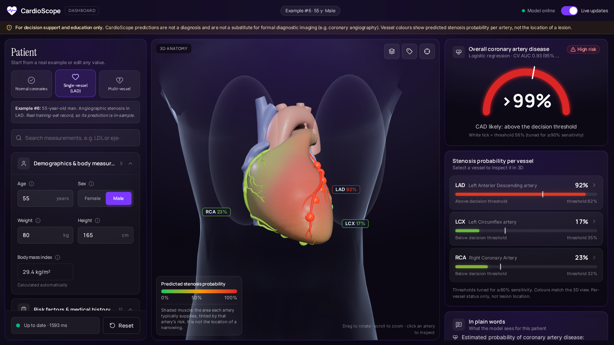
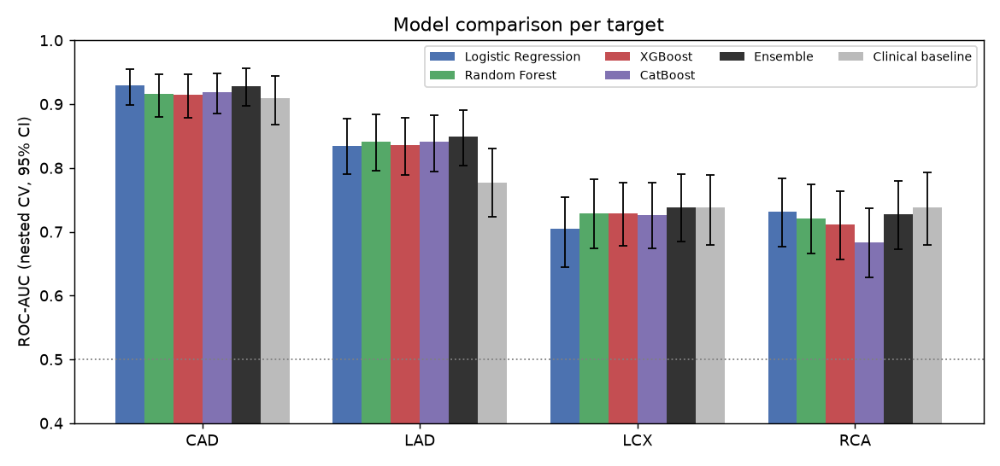
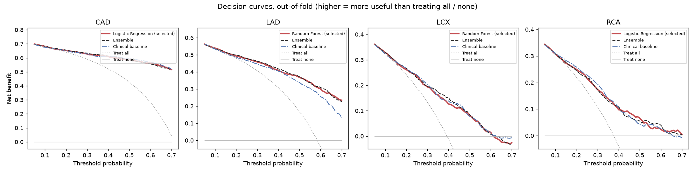

# CardioScope: Interactive 3D Cardiovascular Risk Visualisation

**Multimodal AI Hackathon 2026, Track A** · Live app: https://frontend-psi-one-41.vercel.app ·
API: https://cardioscope-api.onrender.com · Code: https://github.com/ayush-dev-001/Cardio

> **Clinical disclaimer.** CardioScope is for decision support and education only. It is not a
> diagnosis and not a substitute for formal diagnostic imaging (e.g. coronary angiography). It
> predicts per-vessel stenosis *status*, not the location of a lesion within a vessel.

## 1. Overview
CardioScope takes a patient's routine clinical data (demographics, examination, ECG, laboratory
and echocardiography) and returns:
- the probability of **overall coronary artery disease (CAD)**;
- the probability of significant stenosis in each of the **LAD, LCX and RCA**.

The vessel probabilities colour the matching arteries of an interactive 3D heart inside a
transparent torso. A clinical dashboard explains every prediction with exact SHAP contributions,
shows each measurement against its normal range, and summarises the result in plain words. Edits
and what-if sliders update the probabilities, the explanations and the 3D colours in under a
second.



## 2. Dataset and preprocessing
**Data.** Extension of the Z-Alizadeh Sani dataset (UCI): 303 patients, 55 clinical features and
4 labels:
- `Cath`: overall CAD, 71 % positive;
- `LAD`: 58 % stenotic;
- `LCX`: 39 % stenotic;
- `RCA`: 38 % stenotic.

The raw Excel file is never modified. A fixed recoding script (`cardioscope_ml.data`) writes
`data/processed/`. It has no fitted steps, so it cannot leak information across folds.

**Cleaning:**
- Binary flags in both `0/1` and `Y/N` form were unified.
- The `Fmale` typo was fixed.
- Valvular disease was coded as ordinal 0–3; bundle-branch block stays categorical.
- A constant column (`Exertional CP`) was dropped.

There are no missing values and no duplicates. Lab outliers (e.g. triglycerides up to 1050 mg/dL)
are clinically plausible and inside the configured `valid_range`, so they were kept. BMI and the
"obesity" flag are exact functions of weight and height. The API therefore computes them on the
server, so inputs can never contradict each other.

**Label structure.** CAD equals "at least one stenotic vessel" for 302 of 303 patients. The one
exception (row 93) is kept as provided and documented. Vessel labels are correlated (phi
0.28–0.39), so we also tested a classifier chain (section 3).

**Feature dictionary.** `ml/configs/features.yaml` describes all 54 model features: type, unit,
medical meaning, normal range, plausibility range and display group (demographic / exam / lab /
ECG / echo). The same file drives the training matrix, the API's input validation, the dashboard
form and the physiology panel.

**Preprocessing inside the folds.** Every model is a scikit-learn `Pipeline(ColumnTransformer →
classifier)`:
- median imputation;
- one-hot encoding of the categorical feature;
- standard scaling for logistic regression only.

The whole pipeline is refit inside every cross-validation fold. Nothing is fitted on the full
dataset before splitting.

**No target leakage.** `LAD`, `LCX`, `RCA` and `Cath` are never inputs. This is enforced three
ways:
1. an assertion in the pipeline;
2. pytest checks on the training matrix and on every saved model;
3. the API rejects unknown fields.

## 3. Model architecture and validation


**Four targets, four model families.** For CAD, LAD, LCX and RCA separately we compare:
- elastic-net logistic regression;
- a random forest (bagged random-subspace trees);
- XGBoost;
- CatBoost.

Families, search spaces and validation settings live in `ml/configs/models.yaml`. Adding a model
means adding a config entry.

**Nested cross-validation:**
- **Outer loop:** repeated stratified 5-fold × 3 (15 test folds), stratified on the joint
  LAD/LCX/RCA pattern. All targets and families share the same splits, so comparisons are paired.
- **Inner loop:** a randomised hyper-parameter search (15 candidates, 3-fold, ROC-AUC), run on the
  outer-training part only.
- **Within each outer-training part:**
  - 5-fold out-of-fold predictions fit a Platt calibrator, kept only if it lowers the Brier score;
  - a decision threshold is chosen as the highest one whose out-of-fold recall is ≥ 90 % (CAD) or
    ≥ 80 % (vessels).

  The calibrator and threshold are then applied, unchanged, to the untouched test fold.
- **Metrics:** computed on pooled out-of-fold predictions, with 1000-sample patient-bootstrap
  95 % confidence intervals.

**Selection and final models.** Per target, the family with the best cross-validated ROC-AUC is
retrained on all 303 patients by the identical procedure. It is saved as one bundle
(`models/<target>.joblib`): pipeline, calibrator, threshold and SHAP explainer.

**Vessel strategy.** Independent per-vessel models were compared with a classifier chain
(LAD → LCX → RCA). The chain passes predicted, never true, probabilities to later links. The chain
gave no significant AUC change for any family, so the deployed vessel models are independent,
which also keeps their explanations purely clinical.

**Explainability.** SHAP values are exact, in calibrated log-odds:
- native TreeSHAP in XGBoost/CatBoost for tree models;
- exact linear SHAP for logistic regression.

Platt scaling is linear in log-odds, so base value + Σ contributions = logit(predicted
probability) holds exactly. This is checked at training time and in tests.

**Reproducibility.** Seeds are fixed and package versions pinned. `python -m
cardioscope_ml.train` runs everything in about 5 minutes on 16 CPU cores. Two independent runs
produce identical metrics and identical predictions.

## 4. Evaluation results
**Selected model per target (nested CV, mean [95 % CI]):**

| Target | Model | ROC-AUC | Recall | Precision | Specificity | F1 | Accuracy | Brier |
|---|---|---|---|---|---|---|---|---|
| CAD | Logistic regression | **0.929** [0.899–0.955] | 0.889 | 0.923 | 0.816 | 0.906 | 0.868 | 0.095 |
| LAD | Random forest | **0.842** [0.796–0.884] | 0.798 | 0.805 | 0.728 | 0.801 | 0.769 | 0.157 |
| LCX | Random forest | **0.729** [0.674–0.782] | 0.773 | 0.532 | 0.560 | 0.630 | 0.644 | 0.204 |
| RCA | Logistic regression | **0.731** [0.677–0.783] | 0.769 | 0.515 | 0.563 | 0.617 | 0.640 | 0.200 |



**How to read the results:**
- **CAD is predicted well, LAD is good.** LCX and RCA are moderate: no routine feature carries much
  signal specific to those vessels.
- **The families are statistically indistinguishable** for CAD, LAD and LCX, so a well-regularised
  logistic regression is fully competitive at n = 303.
- **Calibration:** Platt scaling lowered the Brier score for every target (CAD 0.131 → 0.095), and
  the reliability curves lie close to the diagonal.
- **Recall-first thresholds** reach close to their goals on unseen folds. For LCX and RCA this costs
  specificity (≈ 0.56), so the dashboard always shows the probability, not only a yes/no label.

**Does the model add value? Three checks, all on the same outer splits:**
1. **Clinical baseline:** logistic regression on 10 bedside items (age, sex, chest-pain type,
   diabetes, hypertension, smoking, family history, dyslipidaemia). Paired AUC gain of the selected
   model over it:
   - LAD **+0.064** [+0.031, +0.102], a clear gain through wall-motion abnormality and ejection
     fraction;
   - CAD +0.020 [−0.001, +0.043];
   - LCX −0.010 and RCA −0.006, no gain. We report this honestly: for these vessels the signal
     comes from basic risk factors.
2. **Pre-specified ensemble** (mean calibrated log-odds of all four families): no significant gain
   for any target (largest +0.010 [−0.003, +0.023]). It is not deployed, because it would cost four
   times the compute and make the explanations harder to read.
3. **Decision-curve analysis:** every selected model has higher net benefit than "treat all" and
   "treat none" across risk thresholds of 5–70 % (LCX 5–61 %), i.e. acting on the model would help
   referral decisions.



**What drives predictions** (mean |SHAP|):
- **CAD:** typical chest pain, regional wall-motion abnormality, age, T-wave inversion, diabetes,
  hypertension.
- **LAD:** typical chest pain, wall-motion abnormality, low ejection fraction, age.
- **LCX:** age, chest pain, creatinine, platelets.
- **RCA:** diabetes, chest pain, male sex, age.

These match established cardiology.

## 5. 3D pipeline
**Anatomy:**
- **Heart:** a sculpted model ("Cardiac Anatomy: Coronary arteries of the heart", H. Newey,
  CC BY-NC-SA 4.0). The coronary tree was split into **separate LAD, LCX and RCA meshes**.
- **Torso:** a low-poly body base (Mesh-Base, CC BY 4.0) cropped to the chest and drawn as a glass
  "x-ray" shell.
- **Processing:** a scripted pipeline (`assets/3d/pipeline`) decimates 2.7 M to ~125 k triangles,
  Meshopt-compresses the result (`heart.glb` 438 KB) and exports centre-line landmarks for each
  artery.

**Rendering:**
- React Three Fiber renders the scene on demand: frames are drawn only while the camera moves or
  the data changes.
- Pixel ratio adapts under load. There are no shadows, post-processing or textures.

So the view stays smooth on an ordinary laptop **without a dedicated GPU**. A procedural heart is
the automatic fallback if the model cannot load.

**Spatial risk mapping:**
- Each artery mesh and its six risk nodes take the vessel's predicted probability colour on one
  scale (green 0 % → amber 50 % → red 100 %), shared with the 2D bars and the legend.
- **Supply-territory shading** tints the heart muscle each artery typically supplies with that
  artery's colour (Gaussian fall-off from the artery's centre line). In the single-vessel example
  the front wall (LAD) turns red while the right side (RCA) stays green.
- The legend states that the shading is the supplied territory, not lesion location.

**Interaction:**
- Drag to rotate, scroll or pinch to zoom.
- Hover an artery to highlight it.
- Click an artery (or its label) to fly the camera to it and open the vessel panel: probability vs
  threshold, top SHAP factors and the region it supplies.

**Consistent correspondence.** `shared/vessels.json` is the single vessel-ID registry. Model
targets, API responses, glTF mesh names and 3D landmarks all key on it, and tests fail if any of
them drift apart. Mesh names and territory parameters live in `frontend/src/config/anatomy.json`,
so a new vessel or structure is a config change.

## 6. System integration and usage
**API** (FastAPI, Docker on Render) loads the four models once:
- `GET /schema`: features with units, normal ranges, options and defaults; targets with
  thresholds and CV AUC; vessels; disclaimer;
- `POST /predict`: CAD and per-vessel probabilities, thresholds and risk level;
- `POST /explain`: exact SHAP per target, with values and normal-range status;
- `GET /patients/sample`: real normal, single-vessel and multi-vessel patients, labelled as
  in-sample;
- `GET /health`.

The Pydantic input model is generated from `features.yaml`. It enforces ranges and allowed codes,
and rejects unknown, target or derived fields. A request takes about 15–30 ms.

**Dashboard** (React + TypeScript, Vercel):
- The form is generated from `/schema` and grouped by clinical category.
- Edits and what-if sliders re-predict automatically. A full refresh (prediction + explanation +
  3D colours) takes about 0.7–0.8 s against the deployed API.
- Results:
  - CAD gauge with threshold;
  - vessel bars;
  - SHAP waterfall for any target;
  - physiology panel (each measurement vs its normal range, beside its contribution);
  - vessel detail panel;
  - "In plain words" summary, which also flags the less reliable LCX/RCA predictions.
- The disclaimer banner is permanent.

**Using the live app:**
1. Open https://frontend-psi-one-41.vercel.app/app. After 15 idle minutes the free API needs
   30–60 s to wake.
2. Load a sample patient (Normal, Single-vessel, Multi-vessel) or edit any value.
3. Read the CAD gauge and vessel bars, and rotate the heart.
4. Click an artery for its details.
5. Use the *Why?*, *Physiology* and *What-if* tabs to explore the explanation.

**Running locally** (Linux/macOS/WSL; full commands in `README.md`):
```
pip install -r requirements.txt && pip install -e ml
python -m cardioscope_ml.data && python -m cardioscope_ml.train      # data + models
python -m uvicorn app.main:app --app-dir backend --port 8000           # API
cd frontend && npm install && npm run dev                              # dashboard on :5173
```

**Quality:** 43 ML tests, 33 API tests and 34 frontend tests. They cover:
- leakage;
- fold-safe preprocessing;
- calibration convergence;
- SHAP additivity;
- API validation;
- vessel-ID consistency;
- 3D anatomy.

## 7. Limitations and future work
- **Data:** 303 patients from a single centre, with no external validation. The confidence
  intervals for LCX and RCA are wide.
- **What the model adds:** for LCX and RCA, the full feature set does not beat a bedside baseline.
- **CAD vs vessels:** the CAD and vessel models are separate, so their probabilities need not be
  logically consistent. They are shown side by side.
- **What is predicted:** stenosis status per vessel only, not severity or lesion position. Region
  RWMA is a clinical feature, not a coordinate.
- **Sample patients:** they come from the training set, and their predictions are in-sample (the
  UI says so).
- **Future work:**
  - external validation on a second hospital's data, under ethics approval, with a cardiologist
    partner;
  - vessel-specific inputs (e.g. coronary CT or perfusion imaging) to improve LCX/RCA;
  - patient-specific anatomy.
